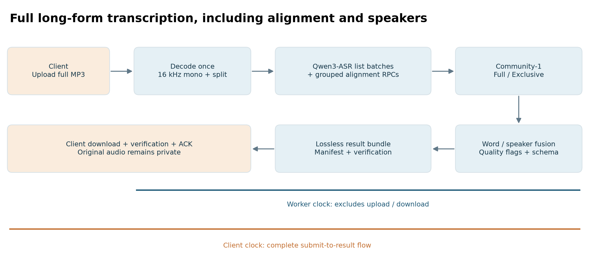
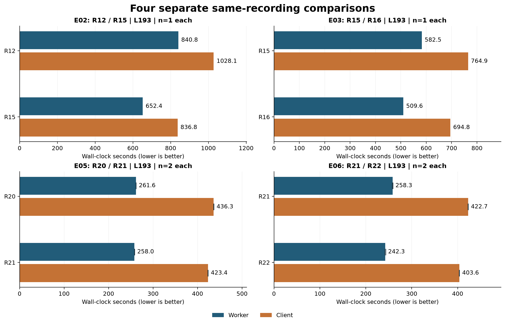
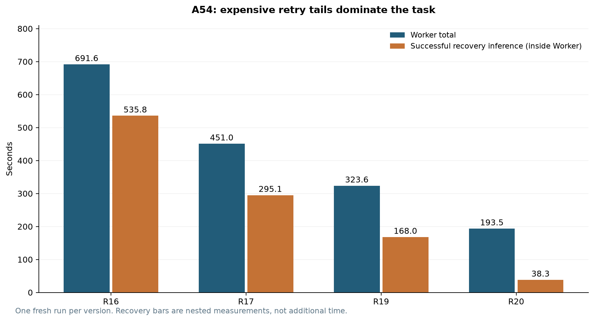
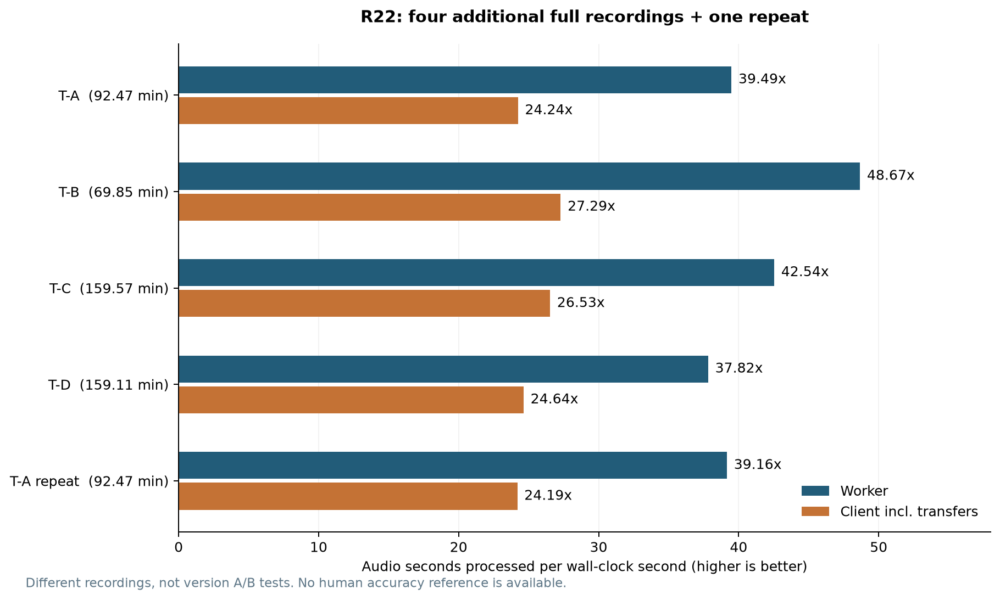

# 一张 RTX A4500，如何把完整课堂转写做到接近 50 倍实时速度

**Omica Chow · 2026-10-18 · 工程实践与实测记录**

一份 193.33 分钟的录音，包含语音识别、词级时间对齐、完整说话人分析和结果融合，远端 Worker 平均用时 **242.31 秒**；从客户端提交到完整结果取回，平均 **403.63 秒**。在随后四份不同录音的验证中，远端速度为 **37.82—48.67 倍实时**，客户端完整流程为 **24.24—27.29 倍实时**。

这些数字来自一张约 20GB 显存的 RTX A4500。使用的仍是 Qwen3-ASR-1.7B、Qwen3-ForcedAligner-0.6B 和 pyannote Community-1，没有通过换小模型、关闭说话人分析或截断转写来提速。

“接近 50 倍”描述的是**处理速度与音频时长的比值**，不表示相对旧版快了 50 倍。不同版本的改进，必须放回同一录音、同一轮对照中计算。本文同时保留没有收益的实验、质量边界和现有问题。

## 1. 我要加速的是整个交付过程

这套系统接收完整长录音，最终交付文本、词级时间信息、匿名说话人、普通及 Exclusive Diarization 时间线，以及异常标记。长文件由内部切分，不需要使用者先手动裁成几十份。



图中的箭头表示数据依赖，不能据此把所有内部计时简单相加。早期版本还尝试过两个分支的有限重叠；当前版本按资源许可分阶段执行，保留共享工作站上的协作锁、检查点和回退。

我分别记录三种指标：

| 指标 | 定义 | 用来回答什么问题 |
| --- | --- | --- |
| Worker 墙钟 | Worker 记录的首个有效执行尝试开始，到最后一次尝试结束的跨度，包含期间的恢复与等待；不包括客户端上传与取回 | 远端处理是否变快 |
| 客户端完整耗时 | 客户端提交、上传、等待、远端处理、结果取回和校验的完整调用耗时 | 使用者多久真正拿到结果 |
| 实时速度 | 音频秒数 ÷ 对应耗时；RTF 则取其倒数 | 1 秒墙钟能处理多少秒音频 |

例如，11,599.96 秒录音 ÷ 242.31 秒 ≈ **47.87 倍实时**，Worker RTF ≈ **0.02089**。同一录音的客户端速度只有 **28.74 倍实时**。把前一个数字写成后一个口径，会明显夸大实际体验。

另一个容易混淆的数字是“ASR 成功推理累计时间”。部分历史日志只累计成功返回的调用，没有完整涵盖失败 OOM、模型装载和调度，它只能作为成本下限。Community 内的嵌入窗口、CUDA Event 和外层阶段墙钟，也有包含关系，不能重复相加。

## 2. 硬件、模型与实验约束

实验在共享工作站上完成。记录到的配置为 RTX A4500、20,470 MiB 显存、64 个逻辑 CPU、约 64GB 系统内存，NVIDIA 驱动 595.99.02。软件版本固定为：

| 组件 | 测试配置 |
| --- | --- |
| Qwen SDK | qwen-asr 0.0.6 |
| PyTorch | 2.8.0+cu126 |
| Transformers | 4.57.6 |
| pyannote.audio | 4.0.7 |
| ASR / ForcedAligner | BF16，SDPA |
| Community | FP32；本轮没有通过降低精度提速，TF32 关闭 |

三个模型均固定权重 revision，见 [方法与环境记录](METHODS.md)。官方 Qwen SDK 本来就提供列表输入和批量推理能力，本文的批处理建立在这些能力上；它不是新模型，也不是重新发明推理后端。[Qwen3-ASR 官方实现](https://github.com/QwenLM/Qwen3-ASR)

多数整文件对照每个版本只跑一次，最后 R21/R22 的主样本各跑两次，并在第二组反转顺序。每个完整任务使用新 GPU 子进程，但操作系统缓存、模型文件缓存、频率和共享负载没有完全控制。因此，小幅差异要谨慎解释；这些结果也不能直接与其他硬件、模型或纯 ASR 榜单横比。

## 3. 先把版本和录音分清楚

为了避免泄露私人录音来源，本文只使用匿名编号。H99 是早期 99.18 分钟样本，D99 是另一份 98.51 分钟讨论录音；**两者不是同一份文件**。S02 和 M15 是同一父录音的 2 分钟、15 分钟截取。C102、L193 和 A54 分别为约 102、193 和 54 分钟样本。后面的 T-A 至 T-D 是额外选取的四份完整归档录音。

下表每行都是自身实验内的同录音对照，百分比表示耗时减少，负值表示变慢。行与行之间不是连续配对，不能把百分比连乘成一个“总提升”。

| 实验 | 同一输入 | 版本 | Worker / 秒 | 减少 | 客户端 / 秒 | 减少 |
| --- | --- | --- | ---: | ---: | ---: | ---: |
| E00 | H99 | serial-stable2 → overlap-stable3 | 944.14 → 854.84 | 9.46% | 1041.94 → 952.16 | 8.62% |
| E01 | L193 | R3 → R12 | 876.57 → 835.86 | 4.64% | 未纳入 | — |
| E02 | L193 | R12 → R15 | 840.81 → 652.36 | 22.41% | 1028.07 → 836.80 | 18.60% |
| E03 | L193 | R15 → R16 | 582.51 → 509.58 | 12.52% | 764.92 → 694.83 | 9.16% |
| E04 | A54 | R16 → R20 | 691.63 → 193.51 | 72.02% | 735.52 → 237.99 | 67.64% |
| E05 | L193 | R20 → R21 | 261.59 → 258.03 | 1.36% | 436.28 → 423.39 | 2.96% |
| E06 | L193 | R21 → R22 | 258.30 → 242.31 | 6.19% | 422.71 → 403.63 | 4.51% |

E00—E04 每版各一次；E05、E06 主样本每版各两次，表中为算术均值。E01 采用当轮报告保留到两位小数的值，客户端数据未纳入本次公开表，不填零。逐次记录和比较范围见 [runs.csv](data/runs.csv) 与 [paired_summary.csv](data/paired_summary.csv)。

同一版本在不同轮次也有明显波动：L193 的 R15 在 E02 为 652.36 秒，在 E03 新鲜对照中为 582.51 秒。R16 的 509.58 秒也不能直接与后来 R20 的约 261 秒相减，再声称差额全部来自重试优化。共享负载、运行条件和阶段开销都需要排查。

最早串行样本的 Worker 为 944.14 秒，对应 6.30 倍实时；最新版本在其他长录音上达到约 38—49 倍实时。**这可以描述为跨样本的历史观察，不能当作同录音实测的 6—8 倍版本加速。** 目前没有把最早串行版与 R22 重新放在同一份录音上测试。



图中各面板采用独立横轴，从零起始。它们展示局部改进的大小，而不是一条跨时段的版本加速曲线。

## 4. 早期经验：让 GPU 更忙，不一定让结果更快

最早的稳定实现逐段识别，ASR batch 为 1。H99 有 248 个核心段，核心长度中位数约 24.15 秒。早期一次改造让 Qwen 分支与 Community 分支在资源允许时重叠，Worker 从 944.14 降到 854.84 秒，减少 9.46%。

但 ASR 自身从 728.81 增加到 753.49 秒，说话人阶段也变慢。总耗时的收益来自重叠覆盖了一部分等待与计算，并不意味着两个模型都运行得更快。资源竞争严重时仍需要串行回退。

另一个实验把片段合并到约 45 秒。部分中文、英文窗口的 ASR 计时下降，但多人样本出现严重不完整和否定表达差异，最终放弃。减少调用次数不能凌驾于内容完整性之上。

后来的 R3 已经使用真正的列表批量 ASR，默认请求 batch64；OOM 时缩小批次，常见成功批次为 32。**请求 64 不代表实际成功处理 64，也不代表同时常驻 64 份模型。** R12 保留了这条主路径，只针对已观察到的恢复问题做小修。

中间筛选也并不顺利：L193 的跨时段初测中，R3 为 626.44 秒，R6 为 1274.37 秒，R8 为 989.30 秒。这些方案没有形成可采用的端到端收益，不能只摘出某次 ASR 微基准的优点。它们与后来的同日 R3 基线条件不同，详细筛选轨迹在 CSV 中标为 `E01-screen`，不用于正文主加速比。

当时还做过 R11：自然停顿切分、长度排序、动态 batch 和阶段顺序一起改变。D99 的 Worker 从 605.88 增至 907.18 秒，慢了 49.73%，并出现新空白风险，整条方案被拒绝。由于同时改变多项机制，不能把所有退化单独归因于“自然切分”。

目前采用的仍是约 25 秒目标、在前方局部低能量位置寻找边界、附带两侧上下文的切分。它不是神经 VAD，也不是每段硬切成完全相同的 25 秒。静音没有被从原始时间轴中删除，核心区间持续覆盖完整录音。

## 5. R15：先消除重复工作，再谈更大 Batch

### Community 真正重复了什么

Community 的嵌入相关窗口很大，但这个窗口包括 CPU 准备、等待、特征提取和模型执行，不能全部称为“GPU Forward 时间”。在一个 15 分钟样本的 profiling 中，Community 外层约 19.50 秒；其中 ResNet 的 CUDA Event 累计约 12.82 秒，fbank 约 0.93 秒。CPU 裁切、堆叠也各有约一秒开销。这些计时存在嵌套与同步关系。

关键发现是：同一段波形会配合不同说话人 mask 多次进入嵌入流程。**声学帧特征相同，按 mask 进行的池化不同。** 因而可以在同一批内共享 fbank 和 ResNet 帧特征，同时对每一个原始 mask 保留原池化及后续输出顺序。

这个样本原有 2,676 个波形/mask 行，只对应 948 个不同声学行。修改后仍处理所有 mask，不丢窗口、不少分析说话人。暖态微基准约从 19.35 秒降到 12.24—13.33 秒。

原始 embedding 数值并非逐位一致，观察到最大绝对差约 2.09×10⁻⁶；普通和 Exclusive 时间线，以及整文件回归检查的语义输出一致。这里能支持“测试集内输出回归通过”，不能外推成任意输入都绝对无损。

在这轮 L193 整文件对照中，Community 外层从 334.88 降到 240.41 秒，嵌入相关窗口从 226.28 降到 137.42 秒。这解释了原先约 227 秒窗口中的主要可消除成本：重复声学特征计算，而非单纯“CPU 没喂饱 GPU”。窗口内仍有准备和等待，不能把整个差额称为纯 CNN 计算节省。

### ForcedAligner：合并 RPC，而不是强行改变 Forward

L193 有 337 次非空逐段对齐。每次调用都付出 RPC、资源观察与调度成本。R15 将多个片段组合到同一次 RPC，统一检查与回传，后端仍逐段执行原来的对齐 Forward。

| L193 对齐指标 | R12 | R15 |
| --- | ---: | ---: |
| RPC 次数 | 337 | 8 |
| 对齐外层阶段 / 秒 | 147.75 | 71.26 |
| 后端 execute 累计 / 秒 | 67.29 | 66.99 |
| 资源观察累计 / 秒 | 58.00 | 1.45 |

下两行包含在对齐阶段中，不能再次加到总时间上。真正省掉的是大量重复外围开销，模型计算几乎没变。资源检查没有取消，而是改变粒度，并保留运行中的负载检查及失败回退。

原生列表 Forward 也实测过：38 个英文非空片段，暖态逐段约 11.72—12.71 秒，batch16 约 5.03 秒。然而 3,808 个边界中有 23 个发生变化，最大约 0.4 秒；当时也没有完成中文、数字及混合语言的充分验证。因此最终采用 **RPC 合并 + 标量 Forward**，没有把这个更快的局部实验写成已上线能力。

### 整文件验收，而不是只报微基准

| 输入时长 | R12 Worker / 秒 | R15 Worker / 秒 | 减少 |
| --- | ---: | ---: | ---: |
| 2.00 分钟 | 91.15 | 99.58 | -9.24% |
| 15.00 分钟 | 122.91 | 108.24 | 11.94% |
| 98.51 分钟 | 597.49 | 505.90 | 15.33% |
| 102.13 分钟 | 473.22 | 388.55 | 17.89% |
| 193.33 分钟 | 840.81 | 652.36 | 22.41% |

长录音有收益，2 分钟样本反而变慢。小文件的加载和等待占比高，固定成本不会因为减少几次计算就自动消失。R13 曾暴露资源退出条件问题，R14 原型未通过单元验证，这些中间版本没有被包装为成功上线版本；R15 修复后才进入验收。

## 6. R16：一个 CPU 循环也能吃掉一分钟

完成 ASR、对齐与说话人分析后，还需要把每一个词匹配到对应的说话人区间。旧实现让每个词遍历大量时间区间，录音越长，这段 CPU 后处理越明显。

R16 使用时间区间索引，先缩小候选集合，再沿用原有重叠计算、并列选择和边界语义。它没有假设词时间戳一定严格递增，也没有改写零时长锚点或半开区间规则。

L193 的 CPU 重放中，这部分从 41.07 秒降到 0.30 秒；新鲜整文件配对中，Worker 从 **582.51 降到 509.58 秒**，客户端从 **764.92 降到 694.83 秒**。Community 本身约 215 秒，几乎没变。

“Community RPC 返回到 Worker 结束”的尾部窗口从 58.66 降到 4.74 秒，但 Worker 共减少 72.93 秒。没有证据把余下所有差额都归因于索引，文章不作这种分摊。

这轮提醒我：GPU 优化之后，要重新画关键路径。CPU 上的词与区间匹配、序列化和磁盘操作，完全可能成为下一个瓶颈。

## 7. R17—R20：让异常重试更便宜，同时保护正常重复讲话

最不稳定的耗时来自少量片段的异常生成。短片段到达 token 预算后，如果直接提高到 4096 token 重试，可能继续生成循环文本。正常段很快结束，少数异常却把整个任务拖长。

A54 是一份 54.28 分钟的 M4A。下面四个版本使用同一输入，在同一轮新鲜运行中测试：

| 版本 | Worker / 秒 | 客户端 / 秒 | 成功恢复推理累计 / 秒 | 4096 token 恢复次数 |
| --- | ---: | ---: | ---: | ---: |
| R16 | 691.63 | 735.52 | 535.79 | 11 |
| R17 | 451.05 | 494.35 | 295.08 | 6 |
| R19 | 323.57 | 367.28 | 167.99 | 3 |
| R20 | 193.51 | 237.99 | 38.27 | 0 |



最终 R20 的 Worker 减少 **72.02%**，客户端减少 **67.64%**。这只适用于这份异常样本，不能写成所有录音都会提速 72%。

这里没有简单削减最大输出 token，也没有把最终文本截短。触发快路径必须同时满足“生成已被预算截断”等条件，以及经过回归验证的严格尾部循环模式；随后走已有声学拆分恢复，子段先用原始预算识别，必要时仍能走大预算路径。

边界条件比算法名字更重要：一个真实的四字符重复案例，在增加预算后恢复了正常内容，说明“看到重复就提前终止”会误伤。因此新规则只覆盖验证过的二字符、五字符模式，保留原单字符保护；正常 EOS 结束的重复输出不被这条新规则直接判为异常。R18 曾因单字符规则回归失败而被淘汰，R19 仍留下五字符循环长尾，最终收敛到 R20。

这轮 A54 的最终文本、词级时间与说话人语义结果和 R16 一致。其他旧长录音的部分恢复树使用回放验证，不能把它们冒充本轮新跑的整文件性能成绩。正常 EOS 循环、其他周期和新的声学异常仍是待研究问题。

## 8. R21：省掉重复传输和重建，收益没有想象中大

R21 对 Community 时间线重建做了保持离散规则的向量化，保留原排序、并列与网格语义；同时给结果包使用无损压缩，减少重复登记 RPC，保留来源校验、原成员哈希和收讫 ACK。

L193 结果包约从 17.11MB 降到 1.32MB，原始 MP3 没有重新编码。客户端的 2MiB/s 传输限速仍按实际传输字节执行。

两次同输入对照的均值为：Worker **261.59 → 258.03 秒**，减少 **1.36%**；客户端 **436.28 → 423.39 秒**，减少 **2.96%**。这个提升确实小，不能因为压缩比好看就把它描述成重大吞吐突破。

另外测试了 embedding batch、线程调整、数据预上传、CUDA Graph、channels-last 和 Conv-BN 融合。部分方案在微基准没有稳定收益，部分捕获失败，部分出现细小数值差异。最终没有为保留新技术而强行上线。更大 batch 甚至可能遇到内核性能台阶；显存剩余并不等于增大 batch 一定更快。

## 9. R22：对严格全零 mask 消除重复推理

进一步观察发现，Community 仍会产生整个 mask 全零的批次。对于本轮固定的 WeSpeaker ResNet34 与 StatsPool 路径，有限帧特征在严格零权重下的池化统计为零，后续 head 输入也相同。

这给出了一个更窄的优化机会：对**满足条件的整批全零 mask**，验证后复用对应输出，而不是重复运行声学网络。所有 segmentation、mask、说话人计数、聚类和两套 diarization 时间线仍保留。

实现没有直接假定数学推导足够。每种当前形状第一次出现时，实际计算原生结果，再与“零特征经过相同池化和 head”的结果做有限性及逐项完全相等检查。只有通过才在本任务内缓存；模型和 SDK 受指纹保护，不同形状、非零微小权重、NaN、训练状态、未知路径或校验失败，都回退原生计算。返回独立副本，缓存不跨任务或模型共享。

可以将它概括成以下执行逻辑；这是解释性伪代码，并非通用 pyannote 插件：

```text
if 固定模型路径匹配 and 当前批次全部 mask 严格为零:
    if 当前形状尚未验证:
        原生输出 = 原来的完整计算()
        候选输出 = 零特征经过原池化与 head()
        仅在有限且逐项完全相等时建立本任务缓存
    命中已验证缓存则返回独立副本，否则返回原生输出
else:
    执行原来的完整计算()
```

在 L193 中，1,087 次 embedding 调用对应 34,773 个波形/mask 行。274 个批次满足全零条件，其中 2 次用于原生校准，272 次复用，涉及 8,704 行。重复声学帧计算量进一步下降，其他行依旧按原规则处理。

最终对照使用 R21→R22、R22→R21 两组顺序，均为完整长文件：

| L193 指标 | R21 均值 / 秒 | R22 均值 / 秒 | 耗时减少 |
| --- | ---: | ---: | ---: |
| Worker | 258.30 | 242.31 | 6.19% |
| 客户端完整流程 | 422.71 | 403.63 | 4.51% |
| Community 外层 | 102.58 | 86.96 | 15.23% |
| Community 后端 | 94.95 | 79.30 | 16.49% |
| 嵌入相关窗口 | 70.76 | 54.95 | 22.34% |

后三行互相包含，不能叠加计算收益。到 Community 前的关键路径约 154 秒，变化很小；收益主要落在预期阶段。2 分钟新鲜回归为 38.77→38.74 秒，基本不变。另一次非相邻短样本参考的客户端甚至从 60.51 增至 69.05 秒，这类不利观测也保留在公开 CSV 中。

## 10. 换四份完整录音，速度是否还成立

主样本调得很好，不代表其他课堂同样快。我预先选定四份不同的完整归档录音，保留 R22 配置不变，逐份跑完整流程，再对 T-A 重复一次。

| 匿名录音 | 时长 / 分钟 | Worker / 秒 | 客户端 / 秒 | 远端实时速度 | 客户端实时速度 |
| --- | ---: | ---: | ---: | ---: | ---: |
| T-A | 92.47 | 140.51 | 228.90 | 39.49× | 24.24× |
| T-B | 69.85 | 86.11 | 153.58 | 48.67× | 27.29× |
| T-C | 159.57 | 225.06 | 360.86 | 42.54× | 26.53× |
| T-D | 159.11 | 252.40 | 387.44 | 37.82× | 24.64× |
| T-A 重复 | 92.47 | 141.68 | 229.35 | 39.16× | 24.19× |

四份独立录音共约 **8.02 小时**；加上重复项，R22 实际处理约 **9.56 小时**。每次均为一个 Worker 执行尝试，出现一次正常的 OOM 缩批回退，没有整任务失败或客户端 RPC 错误，结果经过校验并完成 ACK。



T-A 两次 Worker 相差约 0.83%，客户端相差约 0.20%；两次语义结果一致。四份独立样本的远端速度为 37.82—48.67 倍实时，但 T-B 被说话人模型判为语音活动的时间比例仅约 16.8%，其他三份约为 65.4%—73.9%。这是模型输出的活动代理，不是人工语音标注。不能拿最安静样本的 48.67 倍，承诺连续密集讲话也有同样速度。

本轮成功尝试报告的 ASR allocated 峰值约 13.90GiB，reserved 约 15.78GiB。它们是 PyTorch 的分配/预留指标，并非整卡进程占用，也不保证捕获失败 OOM 的瞬时峰值。Community 的峰值和 ASR 分开记录，不能直接相加当成同时驻留占用。

## 11. “质量不能降”如何验证，又有哪些没证明

执行方式改变后，我优先检查原音身份、解码 PCM、模型与参数，以及完整结果结构。文本、核心片段、词时间、质量标记、普通和 Exclusive 时间线逐项比较；匿名 speaker 编号允许一致的置换，性能计时字段单独排除。相同编号的巧合或只比较拼接文本，均不足以说明结果一致。

R15、R16、R20 以及 R21/R22 的已列对照通过了各自范围内的结果回归。R22 还保留了 OOM 拆批、未知模型路径回退、缓存形状变化、异常 mask 和旧协议兼容性验证。最终 Worker 回归报告有 429 项测试记录，依赖 SDK 的测试另有实际补跑记录；不能把重复覆盖的测试项相加宣传。

但结果相同也可能是相同地犯错。本轮没有可靠人工 Gold，所以**没有测得 CER、WER 或 DER，也不能声称准确率提高或对任意输入完全无损**。

一个具体问题值得公开保留：T-C 的一个片段中，有 15 个词单元无法得到有效精确对齐，按既有规则保留近似区间。为确认是否由 R22 引入，又跑了一次同输入 R21，完整语义结果一致，且同样是这 15 个单元。这支持“并非本次改造新增的回归”，不表示这些时间戳已经准确。

类似地，完整时间轴覆盖不代表每个有声位置都识别正确；空 ASR 核心与说话人活动的交集，只能提示回听风险。系统继续保留 review-recommended、approximate 和 unknown 等状态，不把它们为了统计好看清零。

## 12. 现在最该优化哪里

以 R22 主样本均值计算，Worker 约 242.31 秒，其中 Community 外层约 86.96 秒，占 35.9%。如果它能无成本消失、且不改变其他依赖和资源条件，Worker 最多减少约 35.9%；这是理想上界，不是可实现承诺。对齐外层约 22.34 秒，占约 9.2%，是另一个有明确计时的上界。

客户端完整耗时仍为 403.63 秒。主样本上传与 seal 约 135.54 秒，在当前 2MiB/s 预算下占了显著比例。消除 Community 的同样 86.96 秒，在客户端口径下最多约减少 21.5%；即使远端进一步变快，网络与固定开销也不会消失。MP3 已经高度压缩，试验中的通用无损压缩只减少约 0.1%—0.6%，不能指望像结果 JSON 那样压缩。

下一步更值得做的三件事是：

1. **建立小而可靠的人工标注集。** 覆盖术语、数字、英语、边界和说话人切换，再评估哪些数值变化可以接受；否则不少更快的方案无法放心采用。
2. **针对仍未覆盖的异常生成做局部回放。** 将正常重复讲话作为负例，量化恢复预算与长尾，不随意截断最终输出。
3. **分开测客户端传输与剩余关键路径。** 在不取消共享资源预算的前提下，验证传输、轮询和结果处理能否安全重叠；对 Community 剩余计算再做针对性 profiling。

这次改造中，收益最大的步骤往往很朴素：相同声学特征少算一次，资源观察少做几百次，异常恢复不要反复走昂贵死路，词与说话人区间不要全量两两扫描。它们比“尽量占满显存”更接近真正的优化目标——更快拿到完整、可检查的结果。

## 数据、复算与致谢

公开材料包含本文、逐次匿名测量、比较汇总、图表与复算脚本。运行 `python tools/reproduce.py --check` 可以重新计算比值并检查数据与文章表格；运行不带 `--check` 的命令可重绘图表。详细字段、样本关系和限制见 [METHODS.md](METHODS.md)。

为保护录音参与者，原音、转写正文、人物身份、课程信息、主机地址、凭据和内部任务标识不公开。生产 Worker 源码也不在这个文稿仓库内。因此公开脚本能够复算所报数字与图表，**不能独立复现私有语料的 GPU 性能或验证其识别准确率**。

本文记录作者与 AI 编程助手协作完成的工程实现和测试；文字、图表与数据整理也使用了 AI 辅助。基础模型与 SDK 的贡献属于各自维护者，本文贡献限于这套完整流水线的工程改造、实验和取舍记录。

参考资料：

- [Qwen3-ASR 官方仓库与 SDK](https://github.com/QwenLM/Qwen3-ASR)
- [Qwen3-ASR 技术报告](https://arxiv.org/abs/2601.21337)
- [Qwen3-ForcedAligner-0.6B 模型说明](https://huggingface.co/Qwen/Qwen3-ForcedAligner-0.6B)
- [pyannote Community-1 模型说明](https://huggingface.co/pyannote/speaker-diarization-community-1)
- [PyTorch 2.8 CUDA 与计时说明](https://docs.pytorch.org/docs/2.8/notes/cuda.html)

本文是特定环境与样本下的工程经验，没有进行跨系统排名或同行评议。所有百分比由本仓库数值重新计算，未将微基准、历史参考和不同录音拼成统一加速比。
